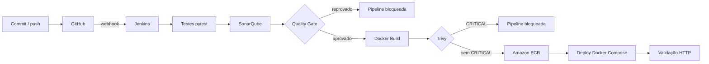

# CivicLens Lite | Pipeline DevSecOps

Global Solution 2026 da FIAP, disciplina DevOps & DevSecOps. Tema **CitizenTech: da cidade ao campo, tecnologia para a vida cotidiana**.

| Participante | RM | Turma |
|---|---|---|
| Anderson Huang | 565920 | TURMA_A_DEFINIR |

## Sobre a aplicação

O **CivicLens Lite** é uma API para cidadãos registrarem e acompanharem ocorrências urbanas (buracos, iluminação apagada, vazamentos, lixo acumulado etc.). Ela é uma adaptação enxuta do backend FastAPI do projeto open source [CivicLens](https://github.com/tejasbhor/Civiclens) (licença MIT). O modelo de domínio foi mantido (categorias, severidade e fluxo de status da ocorrência). As dependências pesadas do original (PostgreSQL/PostGIS, Redis, MinIO e módulos de IA) foram removidas para manter o foco na esteira DevSecOps.

### Endpoints

| Método | Rota | Descrição |
|---|---|---|
| GET | `/health` | Health check, retorna a versão (tag da imagem) em execução |
| GET | `/api/v1/ocorrencias` | Lista ocorrências, com filtros `?status=` e `?categoria=` |
| GET | `/api/v1/ocorrencias/{id}` | Detalhe de uma ocorrência |
| POST | `/api/v1/ocorrencias` | Registra uma nova ocorrência e gera protocolo |
| PATCH | `/api/v1/ocorrencias/{id}/status` | Atualiza o status respeitando o fluxo `recebida → em_andamento → resolvida/rejeitada` |
| GET | `/api/v1/estatisticas` | Totais por status e severidade |
| GET | `/docs` | Documentação interativa (Swagger) |

## Arquitetura DevSecOps



Toda a plataforma roda em uma EC2 Ubuntu 24.04 (t3.large) na AWS, provisionada com Terraform:

| Componente | Função | Onde |
|---|---|---|
| GitHub | Versionamento e gatilho via webhook | `github.com/andhuangg/gs-civiclens-devsecops` |
| Jenkins | Orquestração CI/CD (Jenkinsfile declarativo, configurado via JCasC) | container `jenkins`, porta 8080 |
| SonarQube Community + PostgreSQL | Análise estática e Quality Gate | containers `sonarqube` e `sonar-db`, porta 9000 |
| Trivy | Varredura de vulnerabilidades da imagem | binário dentro da imagem do Jenkins |
| Amazon ECR | Registry das imagens (scan on push habilitado) | `civiclens-lite` |
| Docker Compose | Deploy da aplicação | container `civiclens-app`, porta 8000 |

O Jenkins acessa o ECR por meio de uma IAM Role da instância (sem access keys em arquivo ou credential).

## Estágios da pipeline

| Estágio | O que faz | Bloqueia quando |
|---|---|---|
| Checkout | Clona o commit e define a tag `BUILD-SHA` | |
| Testes automatizados | `pytest` com cobertura (JUnit + coverage.xml) | algum teste falha |
| Análise SonarQube | `sonar-scanner` envia código, cobertura e testes | |
| Quality Gate | `waitForQualityGate abortPipeline: true` | gate reprovado |
| Docker Build | Build multi-stage, imagem não-root | erro de build |
| Trivy Scan | Relatórios TXT, JSON e HTML (HIGH e CRITICAL) | existe vulnerabilidade CRITICAL |
| Publicação no ECR | Push com tag versionada e `latest` | falha de push |
| Deploy (Docker Compose) | `docker compose up -d` com a nova imagem | falha de subida |
| Validação funcional | `scripts/smoke-test.sh`: health, versão, GET, POST e estatísticas | resposta inesperada |

### Quality Gate "CivicLens Gate"

| Métrica | Condição de reprovação |
|---|---|
| Cobertura | menor que 80% |
| Cobertura em código novo | menor que 80% |
| Reliability, Security e Maintainability rating | pior que A |
| Linhas duplicadas | maior que 3% |
| Novos issues | maior que 0 |

## Como executar localmente

Requisitos: Python 3.12+ e Docker.

```bash
python3 -m venv .venv
.venv/bin/pip install -r requirements-dev.txt
.venv/bin/pytest

docker build -t civiclens-lite:local .
docker network create devsecops
docker compose up -d
./scripts/smoke-test.sh http://localhost:8000
```

## Como reproduzir a plataforma

```bash
ssh-keygen -t ed25519 -f ~/.ssh/civiclens-cicd -N ""
cd infra
cat > terraform.tfvars <<VARS
admin_cidrs       = ["SEU_IP/32"]
github_hook_cidrs = ["192.30.252.0/22", "185.199.108.0/22", "140.82.112.0/20", "143.55.64.0/20"]
VARS
terraform init && terraform apply

scp -r -i ~/.ssh/civiclens-cicd ../platform ubuntu@IP_PUBLICO:~/
ssh -i ~/.ssh/civiclens-cicd ubuntu@IP_PUBLICO ./platform/bootstrap.sh
```

O `bootstrap.sh` gera senhas aleatórias em `platform/.env` (fora do Git), sobe SonarQube e PostgreSQL, troca a senha padrão do admin, cria o token de análise, o webhook para o Jenkins e o Quality Gate, e por fim sobe o Jenkins já configurado via Configuration as Code com o job `civiclens-lite`.

Depois basta cadastrar o webhook no GitHub (`Settings > Webhooks`) apontando para `http://IP_PUBLICO:8080/github-webhook/` com evento `push`.

## Estrutura

```
app/            código da API FastAPI
tests/          testes automatizados (pytest)
scripts/        smoke test pós-deploy
Dockerfile      imagem multi-stage, não-root, com healthcheck
docker-compose.yml  deploy da aplicação
Jenkinsfile     pipeline declarativa
sonar-project.properties
platform/       Jenkins (imagem + JCasC), SonarQube e bootstrap
infra/          Terraform da EC2, ECR, IAM e security group
docs/           evidências e relatório
```

## Licença

MIT. Baseado no [CivicLens](https://github.com/tejasbhor/Civiclens) (Copyright (c) 2025 CivicLens). A pipeline DevSecOps, a infraestrutura e a adaptação da API são implementação própria.
